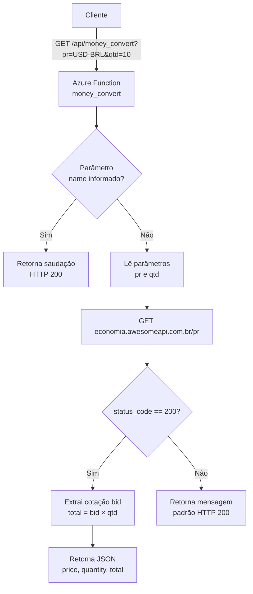

# Conversion Money HTTP

Azure Function (Python) com gatilho HTTP que converte valores monetários usando a API pública
[AwesomeAPI – Economia](https://docs.awesomeapi.com.br/api-de-moedas).

A função recebe um par de moedas e uma quantidade, consulta a cotação atual e devolve o valor total convertido.

## Fluxo do processo



### Etapas

1. **Requisição** – o cliente chama o endpoint HTTP passando o par de moedas (`pr`) e a quantidade (`qtd`).
2. **Roteamento** – o gatilho HTTP anônimo do Azure Functions aciona a função `money_convert`.
3. **Desvio opcional** – se o parâmetro `name` for informado, a função responde apenas com uma saudação.
4. **Consulta externa** – a função chama a AwesomeAPI para obter a cotação atual do par informado.
5. **Cálculo** – o valor de compra (`bid`) é multiplicado pela quantidade solicitada.
6. **Resposta** – o resultado é devolvido em JSON com `price`, `quantity` e `total`.

## Estrutura do projeto

| Arquivo | Descrição |
| --- | --- |
| `function_app.py` | Definição da Function App e da função `money_convert` |
| `host.json` | Configuração do host do Azure Functions (runtime v4) |
| `local.settings.json` | Configurações locais (não versionar valores sensíveis) |
| `requirements.txt` | Dependências Python |

## Pré-requisitos

- Python 3.9+
- [Azure Functions Core Tools v4](https://learn.microsoft.com/azure/azure-functions/functions-run-local)
- [Azurite](https://learn.microsoft.com/azure/storage/common/storage-use-azurite) (ou uma connection string real em `AzureWebJobsStorage`)

## Instalação

```powershell
python -m venv .venv
.\.venv\Scripts\Activate.ps1
pip install -r requirements.txt
```

> A função usa a biblioteca `requests`. Certifique-se de que ela está listada em `requirements.txt`
> antes de publicar na Azure, caso contrário a execução falhará no ambiente remoto.

## Execução local

```powershell
func start
```

A função ficará disponível em:

```
http://localhost:7071/api/money_convert
```

## Endpoint

`GET /api/money_convert`

Nível de autenticação: **anônimo**.

### Parâmetros de query

| Parâmetro | Obrigatório | Descrição | Exemplo |
| --- | --- | --- | --- |
| `pr` | Sim | Par de moedas no formato da AwesomeAPI | `USD-BRL` |
| `qtd` | Sim | Quantidade a ser convertida | `10` |
| `name` | Não | Se informado, retorna uma saudação em vez da conversão | `Maria` |

### Exemplo de requisição

```powershell
curl "http://localhost:7071/api/money_convert?pr=USD-BRL&qtd=10"
```

### Exemplo de resposta

```json
{
  "price": "5.4321",
  "quantity": "10",
  "total": 54.321
}
```

Os campos retornados são:

- `price`: cotação atual (valor de compra / `bid`) do par informado
- `quantity`: quantidade enviada na requisição
- `total`: `price` × `quantity`

## Deploy na Azure

```powershell
func azure functionapp publish <NOME_DA_FUNCTION_APP>
```

## Observações

- A cotação é obtida em tempo real; não há cache nem tratamento de limites de taxa da API externa.
- Se o par de moedas for inválido ou a API externa falhar, a função retorna a mensagem padrão de sucesso
  do gatilho HTTP. Recomenda-se adicionar tratamento de erro explícito antes de usar em produção.
